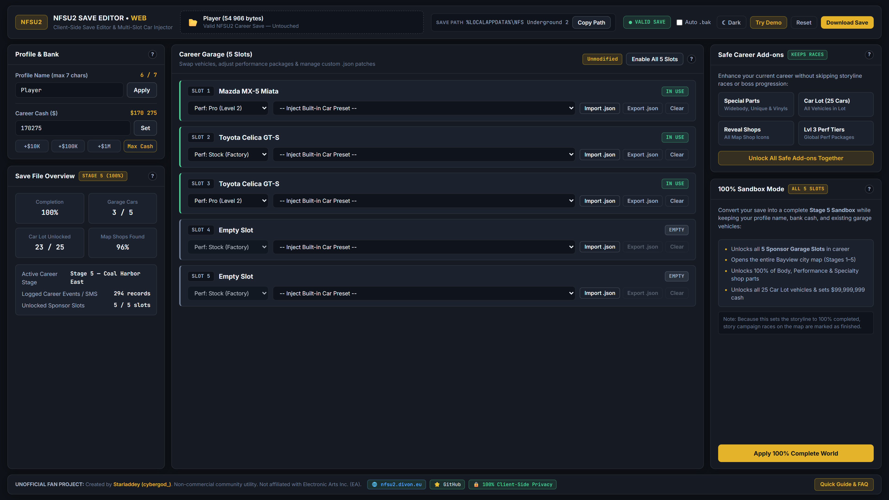

# NFS Underground 2 — Save Editor (Web Edition)

Free, client-side browser utility to edit **Need for Speed Underground 2** career save files. 100% client-side privacy, zero server uploads.

## Live Web App
- **Launch Editor:** [Open NFSU2 Save Editor](https://nfsu2.divon.eu/)

## Key Features
- **Profile & Bank Editor:** Safely rename your career profile (up to 7 ASCII characters) and set up to $999,999,999 career cash.
- **5-Slot Career Garage Manager:** Inspect, unlock, clear, or modify performance tiers (Stock, Street, Pro, Extreme) across all 5 career garage slots.
- **40+ Built-in Car Injector Presets:** Inject Story/Boss icons (Rachel's 350Z, Caleb's Pontiac GTO, Nikki's Mustang, Snoop Dogg's Escalade), Custom Player Builds, EU/US Regional Exclusives (Peugeot 106, Opel Corsa, Honda Civic Si, Acura RSX), and all 26 Factory Stock vehicles.
- **Safe Career Add-ons vs. 100% Sandbox Mode:**
  - *Safe Career Add-ons:* Unlock Widebody kits, TJ Unique upgrades, all 25 Car Lot vehicles, and hidden map shops while keeping active storyline races intact.
  - *100% Sandbox Mode:* Unlock all 5 sponsor garage slots, the entire Bayview map (Stage 5), and 100% of shop catalogs in one click.
- **Custom .JSON Car Patches:** Export and import standalone vehicle patches between save files.

## Backup Warning
Always back up your save files before making changes. This lets you restore your original progress if something goes wrong.

## Save File Location (Windows 10 / 11)
Standard path for Windows Explorer (`Win + R`):
`%LOCALAPPDATA%\NFS Underground 2`

## Running Locally (Offline Mode)

You don't need an internet connection to edit your save files:

1. **Instant Web App (Recommended):** Visit **[nfsu2.divon.eu](https://nfsu2.divon.eu)** and click **"Install App"** (PWA) in your browser's address bar to use it offline anytime.
2. **Standalone Archive:**
   - Download the latest `.zip` from the [Releases](https://github.com/Starladdey/nfsu2-save-editor/releases) page (or clone this repo).
   - Extract the archive and open `index.html` in any modern browser to edit your own save files (`FileReader` and car presets work directly via `file://`).
   - *Note:* If you want to use the `Try Demo` or `100% Sandbox` template buttons locally, run a local HTTP server in the folder (e.g., `npx serve` or `python -m http.server 8000`) due to browser CORS restrictions on `file://` fetch requests.

## Disclaimer
Unofficial non-commercial fan project. Not affiliated with, endorsed, or sponsored by Electronic Arts Inc. (EA) or EA Black Box.
