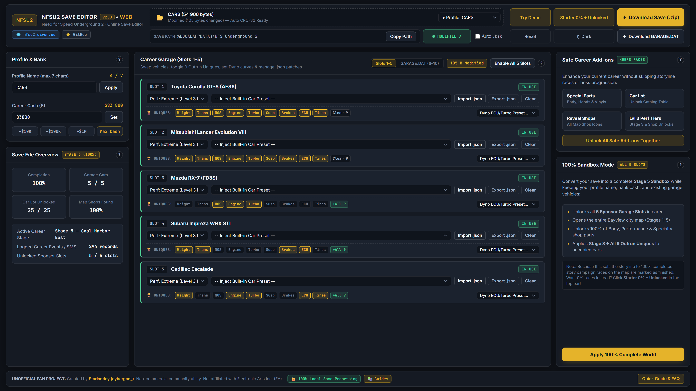

# NFS Underground 2 — Save Editor (Web)

Browser-based utility for editing **Need for Speed: Underground 2** career save files & extended `GARAGE.DAT` files. All file parsing and modifications happen locally in your browser - saves are never uploaded to any server.

## Web Version
- **Live Editor:** [nfsu2.divon.eu](https://nfsu2.divon.eu/)
- **Guides & Documentation:** [nfsu2.divon.eu/guides/](https://nfsu2.divon.eu/guides/)

## Features (v3.0)
- **Profile, Cash & Native `.ZIP` Support:**
  - Rename your career profile (up to 7 ASCII characters) and edit your bank balance.
  - Direct support for exported `.zip` save archives (switch between profiles inside the archive; the download is a ready-to-restore `.zip` with only the profiles you edited, so your other profiles and nfsu2.xyz settings are not overwritten).
- **Career Garage (Slots 1–5) & GARAGE.DAT (Slots 6–10):**
  - Unlock all 5 career garage slots at any point in the game without affecting active map races.
  - Full support for external `GARAGE.DAT` files (Slots 6–10 used by `nfsu2.xyz` and Extra Options).
  - Move or swap cars between any of the slots 1–10.
- **Performance, Outrun Uniques & Dyno:**
  - Switch any car between *Stock*, *Street (Lvl 1)*, *Pro (Lvl 2)*, and *Extreme (Lvl 3)* tuning levels (mixed builds are shown as *Custom*).
  - Toggle all **9 Outrun Unique upgrades** (*Weight, Trans, NOS, Engine, Turbo, Susp, Brakes, ECU, Tires*) individually per car.
  - Apply quick **Dyno ECU/Turbo presets** (*Peak Horsepower*, *Drag Acceleration*, *Drift Torque*, or *Reset to Stock*).
- **40+ Built-in Car Presets:**
  - Story & Sponsor vehicles (*Rachel's 350Z*, *Caleb's GTO*, *Nikki's Mustang*, *Snoop Dogg's Escalade*, *Capone's H2*).
  - Custom Rivals, Player Builds, EU/US regional exclusives (*Peugeot 106*, *Opel Corsa*, *Honda Civic Si*, *Acura RSX*), and all 31 stock cars.
- **Career Overview:**
  - The real game-completion percentage (the same formula as the in-game statistics screen), stages, photo goals, shops and dealer cars, plus a per-stage breakdown.
- **Career Unlocks:**
  - **Safe Career Add-ons:** Fill per-car part unlock tables and mark perf parts as owned without changing your career stage or races. *Reveal Shops* discovers every shop your current stage allows, the way the game does. Dealer cars open as you win career events (or with 100% Career).
  - **100% Career:** Merge career progress from a 100% reference save into yours (all stages and events, stage 6, all 5 slots unlocked). Your name, cars and tuning are kept; cash is raised to at least $777,777.
- **Undo & Download Summary:**
  - Undo any change (Ctrl+Z) and see a plain-language list of what changed before you download.
- **JSON Car Patches & Checksums:**
  - Export and import complete car builds as `.json` files (format v2: body/visuals, uniques, installed parts, dyno, ownership; v1 files still import).
  - Checksums are verified on load (warning if the original file was already damaged) and all three CRC-32 sums are recalculated on download.
  - The `GARAGE.DAT` fingerprint is re-linked automatically when you edit a paired career save.

## Backup Note
Always keep a backup of your original save files before editing (you can also enable the **Auto `.bak`** checkbox in the top bar).

## Guides
- [NFSU2 Save File Location (Windows 10/11 & Web Port)](https://nfsu2.divon.eu/guides/nfsu2-save-file-location/)
- [How to Get Rachel's 350Z & Boss Cars in Career Mode](https://nfsu2.divon.eu/guides/rachel-350z-nfsu2/)
- [Outrun Unique Parts & Stage 3 Performance Guide](https://nfsu2.divon.eu/guides/nfsu2-outrun-unique-parts/)
- [5–10 Slot Garage & GARAGE.DAT Editor Guide](https://nfsu2.divon.eu/guides/nfsu2-garage-dat-editor/)
- [NFSU2 Online Money Trainer Guide](https://nfsu2.divon.eu/guides/nfsu2-money-trainer/)
- [NFS Underground 2 PC Cheat Codes](https://nfsu2.divon.eu/guides/nfsu2-cheat-codes-pc/)

## Save File Location (Windows)
Press `Win + R` and paste:
`%LOCALAPPDATA%\NFS Underground 2`
*(See the [Save File Location Guide](https://nfsu2.divon.eu/guides/nfsu2-save-file-location/) for `nfsu2.xyz` `.zip` export and restore steps).*

## Running Locally
1. **Web App (PWA):** Open [nfsu2.divon.eu](https://nfsu2.divon.eu/) and install it via your browser's address bar for offline access.
2. **From Archive / Repository:**
   - Download the latest `.zip` from [Releases](https://github.com/Starladdey/nfsu2-save-editor/releases) or clone this repository.
   - Open `index.html` in your browser to load and edit local save files.
   - *Note:* To use the `Try Demo` or `100% Career` buttons locally, run a local HTTP server in the project folder (for example, `npx serve` or `python -m http.server 8000`), as browsers block `fetch()` requests over `file://`. Windows may also block saves downloaded from a page opened as `file://` ("this file is potentially dangerous"); with a local HTTP server (or the live site) this does not happen.

## Credits & Disclaimer
- [NFSU2 Save File Technical Documentation](https://github.com/hackch/NFSU2-Savegame-Editor/blob/main/technical.md) (MIT, © 2025 Christopher Hack)
  - Technical research on save file structure and decryption.
  - Shop discovery and career completion rules, car donor data (Nissan Sentra, Ford Focus).
- [Fork - okbrown/nfsu2-save-editor](https://github.com/okbrown/nfsu2-save-editor) (MIT)
  - Career goal tables read from `GLOBALB.BUN` (main events, photo goals, shops, dealer cars), used for the completion percentage, per-stage progress and Reveal Shops.
- Special thanks to players on r/NFSU2 for testing and feedback.

Unofficial non-commercial fan project. Not affiliated with, endorsed, or sponsored by Electronic Arts Inc. (EA).